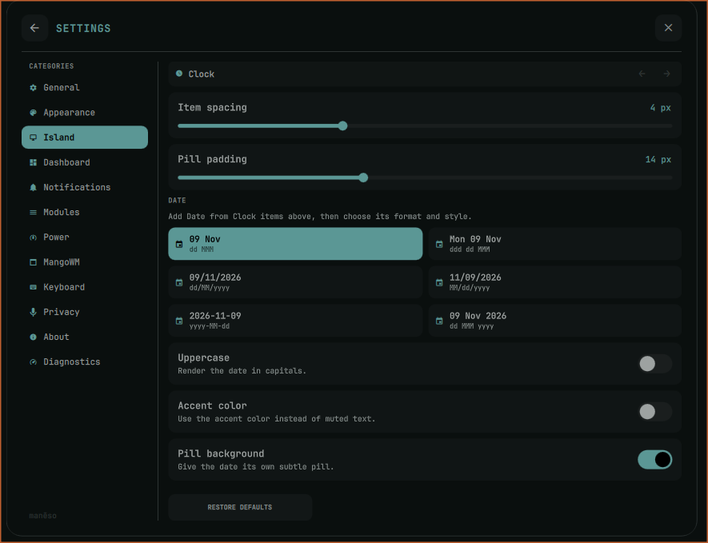

# Changelog

All notable changes to manēso. Format follows
[Keep a Changelog](https://keepachangelog.com/en/1.1.0/); versions use
[Semantic Versioning](https://semver.org/).

## [0.5.0] - 2026-11-09

First tagged release.

### Added

- Animated Dynamic Island for MangoWM: collapsed bar with workspace tags,
  Mango overview awareness, focused window, keyboard layout, network,
  Bluetooth and power indicators.
- Hover dashboard in a compact square layout, closing on `Escape`, sized to
  its content.
- Notification centre with history and grouping, plus inline notifications in
  the dashboard and bell/privacy controls.
- Media OSD with MPRIS and MPD backends, driven over native sockets.
- Event-driven volume OSD, layout OSD and inhibitor OSD.
- Native Wi-Fi and Bluetooth dialogs embedded in the island.
- Privacy indicators for microphone and screen-capture use.
- System tray menus and a configurable date item.
- Power profile menu with keyboard navigation.
- Settings centre: navigation, diagnostics and persisted state, with pages for
  General, Appearance, Fonts, Island modules, Notification, Display and
  volume, Keyboard layout, Mango workspaces, Collapsed items, Power, Dashboard,
  and per-module detail controls.
- Island UI scale, pixel font sizing and dashboard customisation.
- Matugen colour reload from the matugen cache.
- IPC `island help` command listing registered functions.
- Configurable date in the collapsed bar: six formats (`dd MMM`, `ddd dd MMM`,
  `dd/MM/yyyy`, `MM/dd/yyyy`, `yyyy-MM-dd`, `dd MMM yyyy`), plus uppercase,
  accent colour and an optional pill background.

  

### Changed

- Renamed the project to manēso.
- Audio volume now uses PipeWire directly instead of `pactl`.
- Network, Bluetooth, Mango state and power profiles use native interfaces
  instead of `nmcli`, `mmsg` and `udevadm` subprocesses.
- Settings and other heavy pages are loaded lazily to keep the first frame fast.

### Fixed

- Expanded island no longer over/under-sizes relative to its dashboard content.
- Menu keyboard focus restored after opening a tray or power-profile menu.

### Docs

- README demo, MIT license, and configuration split into `CONFIGURATION.md`
  and `INSTALL.md`.
