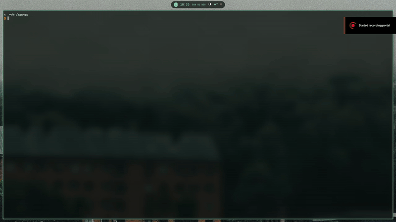

<table>
  <tr>
    <td width="132" valign="middle">
      
    </td>
    <td valign="middle">
      <h1>manēso</h1>
      <p><strong>manēso — A Dynamic Island for MangoWM</strong><br>
      <strong>Your desktop, in motion.</strong><br>
      A modern, animated Dynamic Island for MangoWM on Wayland. Built with Quickshell and QML.</p>
    </td>
  </tr>
</table>



## Features

- Animated island with hover or click expansion
- Workspace tags, focused window, and keyboard layout indicators
- Media controls via MPRIS and MPD
- Volume, brightness, and keyboard-layout on-screen displays
- Notification center with history and grouping
- System tray, privacy indicators, and system statistics
- Bluetooth, network, and power status
- Built-in settings panel
- Matugen color integration
- IPC commands for scripting and keybindings

## Requirements

- MangoWM on Wayland
- [Quickshell](https://quickshell.org/) with Qt 6 QML
- `wpctl` for PipeWire volume control
- `brightnessctl` for internal display brightness
- `ddcutil` for external display brightness
- `ffmpeg` for extracting MPD artwork

These tools are only needed for the features that use them. The diagnostics page
reports any missing tools, including `notify-send` if it is not installed.

## Installing Quickshell

### Arch Linux

```sh
sudo pacman -S quickshell
```

For the latest git version from the AUR:

```sh
yay -S quickshell-git
```

The AUR command assumes `yay`; substitute your preferred AUR helper.

For other distributions and manual build instructions, see [INSTALL.md](INSTALL.md).

Depending on your setup, install `qtsvg`, `qtimageformats`, `qtmultimedia`, and
`qt5compat` for SVG icons, additional image formats, media, and blur effects.

## Running

Run the configuration directly from its checkout:

```sh
qs -p /path/to/maneso
```

Alternatively, place or symlink the checkout at
`$XDG_CONFIG_HOME/quickshell/maneso` and launch it by name:

```sh
qs -c maneso
```

## Configuration

See [CONFIGURATION.md](CONFIGURATION.md) for all available settings, their defaults, and accepted values.

## IPC

The island keeps its existing `island` IPC target so that current scripts and
keybindings continue to work:

```sh
qs -c maneso ipc call island toggle
qs -c maneso ipc call island status
qs -c maneso ipc call island toggleNotifications
qs -c maneso ipc call island toggleSettings
```

If you launch the configuration with `qs -p`, pass the same path to the IPC
command instead, for example
`qs -p /path/to/maneso ipc call island toggle`.

## Naming

- User-facing name: **manēso**
- ASCII identifier: **maneso**
